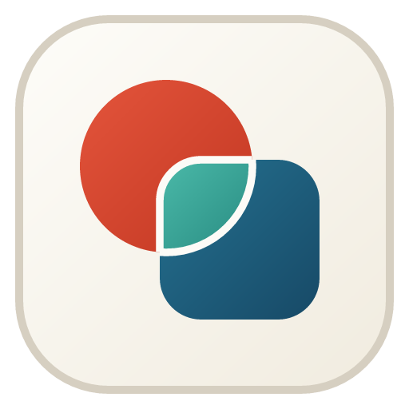
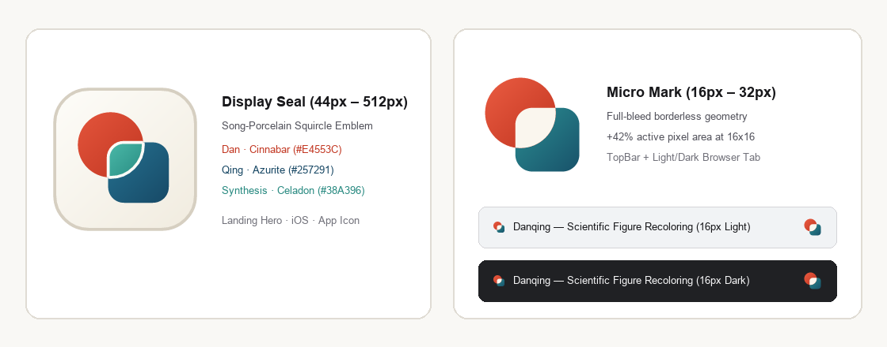

<div align="center">



# Danqing · 丹青

### New color for discovery, faithful to every datum
#### 赋科研以丹青，守数据之本真

<p>
  <a href="./README.zh-CN.md"><strong>简体中文文档</strong></a> ·
  <a href="#-why-danqing">Why Danqing</a> ·
  <a href="#-quickstart--zero-cost-deployment">Quickstart &amp; Cloud</a> ·
  <a href="#-manuscript-match--the-3434-palettes">Manuscript Match &amp; 3,434 Palettes</a> ·
  <a href="#-agent-plugin--mcp-server">Plugin &amp; MCP</a> ·
  <a href="#-citation--attribution">Citation</a>
</p>

[](https://danqing.onrender.com)
[](https://github.com/owehann/danqing/actions/workflows/ci.yml)
[](https://render.com/deploy?repo=https://github.com/owehann/danqing)
[](#-manuscript-match--the-3434-palettes)
[](#-agent-plugin--mcp-server)
[](./LICENSE)

</div>

<br/>

## ✨ Why Danqing

Scientists and students shouldn't lose hours tweaking hex codes, re-running plotting scripts twenty times, and staring at harsh or muddy colors just to make manuscript figures comfortable to read.

**Danqing (丹青)** lets every scholar recolor finished vector figures — PDFs and SVGs exported from **R (`ggplot2`)**, **Python (`matplotlib` / `seaborn` / `scanpy`)**, **GraphPad Prism**, or **Adobe Illustrator** — in seconds, free and open-source, without altering a single coordinate, text glyph, or raw experimental image pixel.

<table width="100%">
  <tr>
    <td width="50%" valign="top">
      <h3>📖 1. One-Click Manuscript Match</h3>
      <p>Pick a scholarly tone (<em>CNS Clean</em>, <em>Clinical</em>, <em>Omics Atlas</em>, <em>Mineral &amp; Museum</em>) or type your target journal and field (optional Gemini 2.5 Flash + built-in perceptual comfort ranker) to match the whole paper's figure set without trial-and-error.</p>
    </td>
    <td width="50%" valign="top">
      <h3>🎯 2. Lossless Vector Engine &amp; Gate G0 Shield</h3>
      <p>Parses PDF content streams and SVG stylesheets under strict <code>preview == export</code> parity while physically locking <strong>Western blot lanes, H&amp;E sections, immunofluorescence, and EM micrographs</strong> (verified bit-identical on export).</p>
    </td>
  </tr>
  <tr>
    <td width="50%" valign="top">
      <h3>🎨 3. 3,434 Verified Palettes &amp; Paired Ramps</h3>
      <p>Spans <strong>Accessible</strong> (Okabe–Ito, Petroff IEEE VIS, Paul Tol), <strong>Journal &amp; Scientific</strong> (NPG/NEJM/Lancet, CNS Iso-Chroma, <code>pypalettes</code>), <strong>World Museums</strong> (<code>MetBrewer</code>, <code>MoMAColors</code>, <code>nice-color-palettes</code>), <strong>CC0 Eastern Artifacts &amp; Sanzo Wada</strong>, and <strong>Crameri v8.0 / cmocean</strong> continuous maps — every palette paired with homologous 7-stop sequential &amp; diverging ramps.</p>
    </td>
    <td width="50%" valign="top">
      <h3>🤖 4. Antigravity Plugin, MCP &amp; Zero-Retention Privacy</h3>
      <p>Ships with a native <strong>MCP server (<code>danqing_mcp</code>)</strong> and <code>plugin.json</code> for Google Antigravity, Claude Code, and Cursor, plus <strong>100% RAM-only multi-visitor isolation</strong> and ready-to-paste <code>ggplot2</code> &amp; <code>matplotlib</code> export snippets.</p>
    </td>
  </tr>
</table>

<br/>

<div align="center">
  
</div>

<br/>

---

## 🚀 Quickstart & Zero-Cost Deployment

### Option A · Use Online Immediately (Free Forever)
Open **[https://danqing.onrender.com](https://danqing.onrender.com)** in any desktop browser (`≥ 600 px`).

### Option B · Local Studio (3 Commands)

```bash
pip install -e ".[dev]"
(cd web/frontend && pnpm install && pnpm build)
./scripts/start_studio.sh
```

Open `http://127.0.0.1:8765`.

### Option C · Instant Share Link or Self-Hosted \$0 Cloud

```bash
./scripts/share_public.sh          # Public HTTPS link via Cloudflare Quick Tunnel ($0)
./scripts/share_public.sh --lan    # Lab / campus Wi-Fi LAN mode ($0)
```

[](https://render.com/deploy?repo=https://github.com/owehann/danqing)

---

## 🎨 Manuscript Match & The 3,434 Palettes

Click **Manuscript Match (`论文配色定调`)** in the studio sidebar to select a journal aesthetic (`CNS Clean`, `Clinical`, `Omics Atlas`, `Mineral & Museum`) or describe your manuscript (with optional session-only Google AI Studio Gemini key support and zero-cost perceptual fallback). Every discrete palette also exposes homologous 7-stop `paired_sequential_stops` and `paired_diverging_stops` so discrete panels and heatmaps stay visually unified.

| Collection | Count | Representative Palettes & Provenance |
| :--- | :---: | :--- |
| **Accessible** | `16` | Okabe–Ito, Petroff 6/8/10 (*Matplotlib 3.10 / IEEE VIS*), IBM Safe, Paul Tol (*Bright, Vibrant, Muted, High-Contrast*), CARTO Safe |
| **Journal & Data-Vis** | `728` | 22 curated CNS Iso-Chroma series (*Nature Immunology*, *Cell Spatial Atlas*, *Science Translational*, *Cancer Discovery*, *Nature Medicine*), NPG/AAAS/NEJM/Lancet/JAMA/JCO (`*-inspired`), LocusZoom GWAS, Observable 10, Seaborn, Scanpy 10 & academic visualization schemes |
| **Museum, Art & Design** | `2,094` | Metropolitan Museum of Art (`MetBrewer`, CC0), MoMA (`MoMAColors`, MIT), `PNWColors`, `NatParksPalettes`, Ghibli/cinema & `nice-color-palettes` (MIT) |
| **Eastern & Sanzo Wada** | `252` | 24 deterministic CC0 Cleveland Museum of Art mineral artifact suites (Ru/Jun/Longquan celadons, Zhao Mengfu landscape, Hokusai Red Fuji) + 228 Sanzo Wada (1933) *Dictionary of Color Combinations* (MIT) |
| **Many Colors (Single-Cell)** | `13` | Polychrome 36, Green-Armytage 25, Scanpy 20, Zeileis 28 & Ultra-Cluster 64, Kelly 22, Glasbey + dynamic hull expansion (`K > N`) |
| **Continuous & Diverging** | `325` | 6 CNS white-paper ramps (`cns_ramp_*`, `cns_div_*`), Crameri *Scientific colour maps* v8.0 (`batlow`, `lipari`, `navia`, `vik`, `roma`, `bam`), `cmocean`, Viridis/Cividis, ColorBrewer 2.0, zero-midpoint lock |
| **Domain Conventions** | `6` | COSMIC SBS-6 mutational signatures, Manhattan alternating chromosomes, Volcano `Up/Down/NS`, Cell Cycle `G1/S/G2M`, CNV `Gain/Loss/Neutral`, `A/C/G/T` bases |

---

## 🤖 Agent Plugin & MCP Server

Danqing is packaged as a ready-to-use **Google Antigravity Plugin** ([`plugin.json`](./plugin.json) + [`mcp_config.json`](./mcp_config.json) + [`skills/danqing/SKILL.md`](./skills/danqing/SKILL.md)) and standard **MCP stdio server** (`danqing-mcp` / `python -m danqing.mcp_server`) exposing four tools:

- `danqing_inspect_figure` — Inspect discrete groups, panels, continuous scales, protected raw images, and deuteranopia diagnostics.
- `danqing_match_manuscript_palettes` — Recommend the 3 most comfortable palettes for a figure or manuscript brief.
- `danqing_recolor_figure` — Losslessly recolor a `.pdf` or `.svg` with byte-level geometry/image verification plus `.palette.R` & `.palette.py` code output.
- `danqing_list_palettes` — Search and filter the 3,434 verified palettes (including homologous paired gradient stops).

---

## 📝 Citation & Attribution

Created and maintained by **Xinyin Han** ([@owehann](https://github.com/owehann)). If Danqing saves you time preparing figures or manuscripts, please cite the software (GitHub's **Cite this repository** button reads [`CITATION.cff`](./CITATION.cff) automatically):

```bibtex
@software{han2026danqing,
  author       = {Han, Xinyin},
  title        = {{Danqing: Lossless Scientific Figure \& Manuscript Recoloring Studio}},
  year         = {2026},
  version      = {0.3.0},
  url          = {https://github.com/owehann/danqing},
  license      = {Apache-2.0}
}
```

- **Code & Brand Assets**: [Apache License 2.0](./LICENSE) — Copyright © 2026 Xinyin Han (`0` GPL/AGPL runtime dependencies).
- **Palette Provenance & Public Benchmark Datasets**: Documented in [`NOTICE`](./NOTICE) and [`core/danqing/palettes/VERIFICATION.md`](./core/danqing/palettes/VERIFICATION.md).
