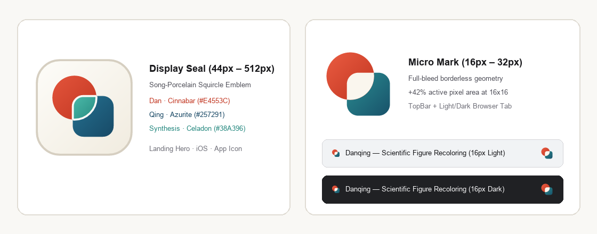

<div align="center">


# 丹青 · Danqing

### 赋科研以丹青，守数据之本真
#### New color for discovery, faithful to every datum

<p>
  <a href="./README.md"><strong>English Documentation</strong></a> ·
  <a href="#-核心特性">核心特性</a> ·
  <a href="#-快速启动与零成本公网部署">快速启动与云部署</a> ·
  <a href="#-277-套权威核验配色库">277 套配色库</a> ·
  <a href="#-多用户隐私隔离与原始证据护盾">隐私与证据护盾</a> ·
  <a href="#-ai-agent-skill-与-python-接口">Agent Skill</a>
</p>

[](https://github.com/owehann/danqing/actions/workflows/ci.yml)
[](https://render.com/deploy?repo=https://github.com/owehann/danqing)
[](#-277-套权威核验配色库)
[](#-多用户隐私隔离与原始证据护盾)
[](./SKILL.md)
[](./LICENSE)

</div>

<br/>

## ✨ 核心特性

**丹青（Danqing）** 专为已绘制完成的科研矢量图而生——不动分毫原始坐标、字体与实验像素，为 **R (`ggplot2`)**、**Python (`matplotlib` / `seaborn` / `scanpy`)**、**GraphPad Prism** 与 **Adobe Illustrator** 导出的 PDF 或 SVG 图表一键重赋经过色觉与学术溯源核验的 **277 套权威科研与东方馆藏矿物配色**。

<table width="100%">
  <tr>
    <td width="50%" valign="top">
      <h3>🎯 1. 所见即所得的无损矢量引擎</h3>
      <p>深度解析 PDF 内容流（<code>rg/RG/g/G/k/K</code>、<code>ICCBased</code>/<code>DeviceCMYK</code>/<code>Indexed</code>/<code>Separation</code> 色彩空间、嵌套 <code>/Form</code> XObject、多页单页精选）与 SVG 样式表（<code>&lt;style&gt;</code>、内联属性、继承组、<code>currentColor</code> 与耦合渐变），严格保证 <code>预览 == 导出</code>。</p>
    </td>
    <td width="50%" valign="top">
      <h3>🛡️ 2. Gate G0 原始实验图像护盾</h3>
      <p>自动识别并物理锁定图表内嵌的 <strong>Western blot 条带、H&amp;E 病理切片、免疫荧光与电镜照片</strong>，导出前后逐字节校验 SHA-256 哈希一致，严守学术图像伦理底线。</p>
    </td>
  </tr>
  <tr>
    <td width="50%" valign="top">
      <h3>🎨 3. 7 大馆藏级核验色库（277 套）</h3>
      <p>囊括 <strong>色盲无障碍标准</strong>（Okabe–Ito、Petroff、Paul Tol）、<strong>顶刊启发与数据科学</strong>（NPG/NEJM/Lancet 风格、CNS 等彩度十二色）、<strong>世界艺术馆藏</strong>（大都会 <code>MetBrewer</code>、MoMA）、<strong>24 套克利夫兰博物馆 CC0 东方器物矿物色</strong>、<strong>单细胞高维多簇</strong>及 <strong>Crameri v8.0 / cmocean</strong> 连续色阶。</p>
    </td>
    <td width="50%" valign="top">
      <h3>🔒 4. 密码学级多访客隔离与代码联动</h3>
      <p>支持公开分享与课题组共用：<strong>100% 纯内存零落盘</strong>，256-bit HMAC-SHA256 访客签名隔离（A/B 用户完全不可见彼此图片），内置生理级色盲预演，一键导出无损矢量图与配套 <code>ggplot2</code> / <code>matplotlib</code> 代码。</p>
    </td>
  </tr>
</table>

<br/>

<div align="center">
  
</div>

<br/>

---

## 🚀 快速启动与零成本公网部署

### 方式一：本地工作台启动（3 条命令）

```bash
pip install -e ".[dev]"
(cd web/frontend && pnpm install && pnpm build)
./scripts/start_studio.sh
```

在浏览器打开 `http://127.0.0.1:8765` 即可使用。

### 方式二：24 小时免费云端部署（Render Free Tier · 免绑信用卡 · \$0.00）

点击下方按钮，基于仓库内置的 [`render.yaml`](./render.yaml) 免费蓝图（`plan: free` + `DANQING_LOW_MEMORY=1`，零绑卡、零超支风险）一键上线你的专属 HTTPS 实例：

[](https://render.com/deploy?repo=https://github.com/owehann/danqing)

### 方式三：免账号秒级公网直链（Cloudflare Quick Tunnel）

```bash
./scripts/share_public.sh          # 生成 https://*.trycloudflare.com 公网加密链接 ($0)
./scripts/share_public.sh --lan    # 同一实验室 / 校园 Wi-Fi 局域网高速模式 ($0)
```

详见 [`docs/FREE_DEPLOYMENT.md`](./docs/FREE_DEPLOYMENT.md)。

---

## 🎨 277 套权威核验配色库

| 分类 | 数量 | 代表配色与学术/馆藏溯源 |
| :--- | :---: | :--- |
| **色盲友好（Accessible）** | `16` | Okabe–Ito、Petroff 6/8/10（*IEEE VIS / Matplotlib 3.10*）、IBM Safe、Paul Tol 全系列、CARTO Safe、ColorBrewer Dark2 |
| **期刊与现代数据科学（Journal）** | `29` | NPG、AAAS、NEJM、Lancet、JAMA、JCO、BMJ（`*-inspired`）、LocusZoom GWAS、Observable 10、Tableau 10、Scanpy 10、CNS 等彩度和谐十二色 |
| **世界馆藏与自然博物（Museum）** | `116` | 大都会博物馆 `MetBrewer` 全集 56 套（CC0）、现代艺术博物馆 `MoMAColors` 30 套（MIT）、太平洋海岸 `PNWColors`、国家公园 `NatParksPalettes` |
| **东方馆藏器物（Eastern · CC0）** | `24` | 自克利夫兰艺术博物馆 48 幅 CC0 高清藏品确定性提取：商青铜爵、唐螺钿镜与三彩、宋汝钧天青霞紫、龙泉青瓷、赵孟頫青绿山水、明成化斗彩、北斋赤富士、雪域矿物唐卡绿度母（均附馆藏链接与缩略图） |
| **单细胞/空间多簇（Many Colors）** | `13` | Polychrome 34、Green-Armytage 25、Scanpy 20、Zeileis 26 / Ultra-Cluster 64、Kelly 22、Glasbey 32 + OKLCH 动态凸包扩展 |
| **连续与发散色阶（Continuous）** | `73` | Crameri v8.0 科学色阶 25 套（`batlowW`、`lipari`、`navia`、`vik`、`roma`）、`cmocean` 13 套、Viridis/Cividis、ColorBrewer 2.0，发散色阶自动锁定零点 |
| **学科常规约定（Conventions）** | `6` | COSMIC SBS-6 突变谱、曼哈顿图染色体双色、火山图 `Up/Down/NS`、细胞周期 `G1/S/G2M`、拷贝数 `Gain/Loss/Neutral`、四碱基 `A/C/G/T` |

---

## 🔒 多用户隐私隔离与原始证据护盾

- **纯内存零留存**：用户上传的未发表图表 100% 仅驻留内存，绝不写入服务器磁盘，删除或闲置 10 分钟立即触发 `gc.collect()` 内存回收，默认关闭访问日志（`--no-access-log`）。
- **多访客密码学隔离**：每次启动生成随机 256-bit 密钥签发 `HttpOnly` 访客凭证 `dq_sid` 与 128-bit 图表句柄，访客之间完全不可枚举、不可互看（跨访客访问一律返回 `404`）。
- **双重导出校验（Gate G6 & Gate G0）**：每次导出 `.zip` 均实时验证矢量几何零偏移与内嵌实验图像字节恒等，并附赠 R `ggplot2` / Python `matplotlib` 调色代码与改色审计表。

---

## 🤖 AI Agent Skill 与 Python 接口

本项目遵循 Agent Skills 规范（详见 [`SKILL.md`](./SKILL.md)），可在 **Claude Code**、**Antigravity**、**Cursor** 或 **Codex** 中直接调用，也可通过 Python API 批量无损重着色：

```python
from pathlib import Path
from danqing.pdf_engine import parse_pdf_scene, export_recolored_pdf
from danqing.solver import solve_scene_colors

scene = parse_pdf_scene(Path("figure.pdf").read_bytes(), "figure.pdf", "fig1", page_index=0)
result = solve_scene_colors(
    scene.entities,
    scene.continuous_scales,
    scene.evidence_regions,
    style_id="east_ru_celadon",      # 宋汝窑天青，或 "okabe_ito", "npg_inspired" 等
    collision_scope="panel_scoped",  # 跨子图同名元素同色一致
)

out_pdf, audit = export_recolored_pdf(scene, result.group_hex, result.scale_stops, verify=True)
assert audit["g6_geometry_identical"] and audit["g0_evidence_bit_identical"]
Path("figure_danqing.pdf").write_bytes(out_pdf)
```

---

## 📜 开源许可与致谢

- **核心引擎、工作台前端与品牌标识**：[Apache License 2.0](./LICENSE)（零 GPL/AGPL 运行时依赖）。
- **调色板原始文献与公开基准数据集致谢**：详见 [`NOTICE`](./NOTICE) 与 [`core/danqing/palettes/VERIFICATION.md`](./core/danqing/palettes/VERIFICATION.md)。
